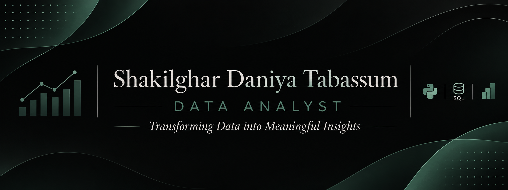

<!--
**Daniya64/Daniya64** is a ✨ _special_ ✨ repository because its `README.md` (this file) appears on your GitHub profile.

Here are some ideas to get you started:

- 🔭 I’m currently working on ...
- 🌱 I’m currently learning ...
- 👯 I’m looking to collaborate on ...
- 🤔 I’m looking for help with ...
- 💬 Ask me about ...
- 📫 How to reach me: ...
- 😄 Pronouns: ...
- ⚡ Fun fact: ...
-->

  

### Aspiring Data Analyst | Python | SQL | Power BI

**Transforming Data into Meaningful Insights.**

I'm an aspiring Data Analyst passionate about transforming raw data into meaningful insights that support better business decisions.

I enjoy exploring datasets, identifying trends, performing data analysis, and building interactive dashboards to solve real-world business problems.

Currently, I'm strengthening my analytical skills and building practical projects using Python, SQL, PostgreSQL, and Power BI.

---

## 💫 About Me

- 🎓 Computer Science and Engineering graduate-in-progress.
- 📊 Interested in Data Analytics and Business Intelligence.
- 🐍 Working with Python, Pandas, and NumPy.
- 🗄️ Practicing SQL and PostgreSQL for data querying and analysis.
- 📈 Building interactive dashboards using Power BI.
- 📑 Using Excel for data analysis and reporting.
- 🚀 Focused on developing practical, business-oriented analytics projects.

---

## 🛠️ Technical Skills

| Category | Technologies |
|---|---|
| Programming | Python |
| Database | SQL, PostgreSQL |
| Data Analysis | Pandas, NumPy |
| Visualization | Power BI, Excel |
| Version Control | Git, GitHub |

---

## 📂 Featured Project

### 📊 Sales & Customer Analytics Dashboard

**Technologies:** Python (Pandas), PostgreSQL, SQL, Power BI

An end-to-end analytics project focused on understanding sales performance, profitability, discount patterns, and customer behavior through data analysis and interactive visualizations.

**Key Contributions:**

- Analyzed sales, profit, discount, and customer performance.
- Performed data cleaning and preprocessing using Python and Pandas.
- Used PostgreSQL and SQL for data querying and business analysis.
- Conducted customer segmentation using RFM (Recency, Frequency, Monetary) analysis.
- Developed interactive Power BI dashboards to monitor important business KPIs.
- Generated actionable business recommendations from analytical findings.

🔗 **[Explore Project Repository](https://github.com/Daniya64)**

---

## 📈 What I'm Currently Focusing On

- Improving Python programming and data manipulation skills.
- Strengthening SQL and database querying techniques.
- Developing advanced Power BI dashboards.
- Practicing real-world data analysis and business case studies.
- Building a strong portfolio of end-to-end analytics projects.

---

## 📊 GitHub Statistics

---

## 🤝 Let's Connect

I'm always interested in connecting with professionals, learning from the data community, collaborating on projects, and exploring opportunities in Data Analytics.

- 💼 **LinkedIn:** [Daniya Tabassum](https://www.linkedin.com/in/daniyatabassum/)
- 💻 **GitHub:** [Daniya64](https://github.com/Daniya64)
- 📧 **Email:** [daniyatabassum113@gmail.com](mailto:daniyatabassum113@gmail.com)

---

### ✨ Transforming Data into Meaningful Insights.

*Thanks for visiting my GitHub profile!*
